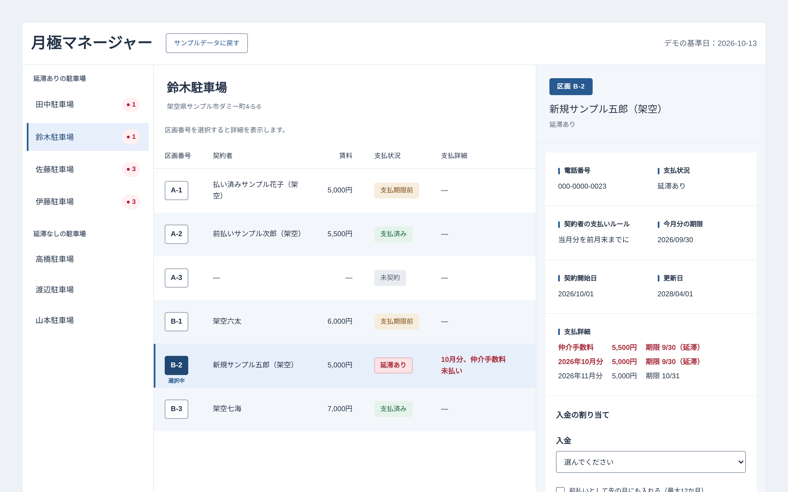

# 月極マネージャー

月極駐車場の契約と入金を管理するためのWebアプリです。知人が管理している月極駐車場の実際の業務をヒアリングして作りました。「誰が、何月分まで払っているか」と「延滞している区画」がひと目で分かることを目指しています。

- デモ：[月極マネージャー](https://tsukigime-manager.vercel.app)
- 設計メモ：[docs/design-notes.md](docs/design-notes.md)



## 作った背景

知人の職場では、駐車場の入金を通帳と担当者の記憶で管理していました。会計ソフトで仕訳をするまで、誰が何月分まで払ったのかが分からないことが、一番の負担になっていました。

ヒアリングの結果、入金の形式が多様なことが分かりました。

- 数か月分をまとめて前払いする人がいる
- 1人で複数の区画を借りて、合計額を1回で振り込む人がいる（会社が3台分など）
- 新しく契約した人は、仲介手数料と最初の月の家賃を一緒に払うことも、別々に払うこともある
- 通帳には、駐車場と関係のない入金も半分ほど混ざっている

このアプリでは、通帳の入金1件ごとに「どの契約の、どの請求に、いくら充てたか」を記録し、支払い状況と延滞を計算で出しています。

## できること

- **延滞のある駐車場がすぐ分かる**：左のリストを「延滞ありの駐車場」と「延滞なしの駐車場」に分け、延滞している区画の数を表示します。最初に開くのは、延滞のある駐車場です
- **区画ごとの支払い状況**：区画の表で、次の状態を表示します
  - 延滞あり：期限を過ぎた未払いがある。「何月分・どの一時金（仲介手数料・更新料）が未払いか」まで出します
  - 支払期限前：今の請求分がまだ払われていないが、期限はまだ来ていない
  - 前払い・支払済み・未契約
  - 料金未登録・要確認：料金や契約者のデータが足りず、判断できない（入力ミスなので、延滞より先に出します）
- **未払いの内訳**：区画を選ぶと、右の詳細に未払いを1件ずつ「何が・残りいくら・期限はいつ」で並べます。延滞の行は色だけでなく「（延滞）」の文字でも示します
- **入金の割り当て**：入金を選ぶと、充てる先と金額のプレビューが出ます。確定すると、支払い状況と延滞がその場で変わります
  - 一部だけの入金（部分払い）にも対応しています
  - この区画に充てる金額を選べます。「2026年10月分まで 8,000円」のようなボタンで、どこまで払うかを選ぶだけで金額が入ります（手で入れることもできます）
  - 使わなかった金額は入金に残り、別の区画に割り当てられます（会社のまとめ払いを3区画に分ける、など）
  - 前払いは、チェックを入れたときだけ先の月にも充てます
- **自動保存**：操作した内容はブラウザ（localStorage）に保存されます。「サンプルデータに戻す」で最初の状態に戻せます

## デモの試し方

サンプルデータの「今日」は2026-10-13に固定しています（日付が変わっても表示が変わらないように）。人名と住所はすべて架空です。

1. 左のリストで「伊藤駐車場」を選ぶ（1・6・10番が延滞しています）
2. 区画の表で区画番号の「6」を押す
3. 右の「入金の割り当て」で7,000円の入金を選び、「割り当てる」を押す
4. 6番の延滞が消え、左のリストの延滞の数が3から2に減ります。6番は「支払期限前」になります（前月末払いの人なので、期限が10/31の11月分がまだ払われていないため）

ほかにも、佐藤駐車場（会社の3台まとめ借り）では、18,500円の入金を3区画に分けて割り当てられます。1番・2番・3番の順に区画を選び、入金を選んで「2026年10月分まで」のボタンで金額を入れて割り当てると、3区画の延滞が消えます。鈴木駐車場のB-2（新規契約）は、10月分と仲介手数料が未払いです。区画を選ぶと、詳細に延滞の2件（仲介手数料・10月分）と期限前の11月分が、金額と期限つきで並びます。まとめて払った10,500円の入金を割り当てると、延滞の2件が消えます。

## 公開版でできないこと

公開版は、サンプルデータで「延滞の確認」と「入金の割り当て」を試すためのデモです。次のことはできません。

- 駐車場・区画・契約者・契約・料金・入金の登録や編集（サンプルデータを操作して試す形です）
- 通帳のCSVの取り込み（取り込み用の項目は型に用意してあります）
- 割り当ての取り消し
- 複数の人・端末でのデータの共有（保存先はそのブラウザのlocalStorageだけです）
- 口座・振込名義・車両・連絡の記録の画面（型だけ用意してあり、画面はまだありません）
- 今日の日付での表示（「今日」は2026-10-13に固定しています）
- 同じ区画での契約の入れ替わり（1区画に契約1件の前提です。詳しくは「今後の改善点」）

## 工夫したところ

詳しい理由と、選ばなかった案は[設計メモ](docs/design-notes.md)に書いています。

- **入金と請求の間に「割り当て」を置いた**：割り当て（Allocation）は「どの入金から、どの請求に、いくら充てたか」を持つ中間のデータです。金額を持つ中間データで入金と請求の多対多の対応を表したので、1件の入金を複数の請求に分けること（仲介手数料＋最初の月）も、1つの請求を何回かに分けて払うこと（9,000円を7,000円＋2,000円）も、同じ形で扱えます
- **保存するものと、計算で出すものを分けた**：人が判断したもの（この入金は駐車場と関係ないなど）だけを保存し、割り当て済みかどうか・残りの金額・延滞は、表示のたびに計算しています。保存した結果と計算し直した結果が食い違うことがありません
- **料金を履歴として持つ**：値上げをしても、過去の月の請求額は変わりません
- **支払い状況を「月」ではなく「期限の日付」で判定する**：契約者ごとに支払いのルールが違います（前月末までに当月分／当月27日まで／翌月末まで など）。「今月分を払ったか」で判定すると、前月末払いの人の来月分（期限は今月末）を見落としたり、期限前なのに「支払済み」と出たりします。そこで「期限が今月末までのもの＝今の請求分」と決め、延滞・期限前・前払いを同じ線で分けました。この線は1つの関数（`billingCutoff`）にまとめています
- **0円の月と、料金が未登録の月を区別する**：事情があって請求しない月は0円、料金を登録し忘れた月は`null`として持ちます。0円の月は払うものがないので延滞にせず、未登録の月は延滞ではなく「料金未登録」として知らせます
- **充てる順番を業務に合わせた**：仲介手数料などの一時金を先に、そのあと古い月から充てます。料金が登録されていない月があれば、そこで止めます（その月を飛ばして先の月を埋めないように）
- **日付を文字列で持つ**：`Date`を使うと、タイムゾーンの変換で日付や月がずれることがあるため、`"2026-10-13"`のような文字列で持っています
- **保存先を差し替えられるようにした**：本番ではNASに保存する予定です。読み書きを`DataSource`（Promiseを返す`load` / `save`）にまとめ、どの保存先を使うかは`src/data/dataSource.ts`の1か所（`dataSource`）で選んでいます。画面側は保存先の種類を知らないので、NAS版を作ったらそこを差し替えるだけで済みます
- **壊れた保存データを、サンプルで上書きしない**：読み込めなかったときはエラーを表示します。黙ってサンプルに切り替えると、自動保存で本物のデータが消えてしまうためです

## 使った技術

| 種類 | 使ったもの |
|---|---|
| 画面 | React 19 |
| 言語 | TypeScript 6（strict） |
| ビルド | Vite 8 |
| テスト | Vitest |
| CSS | CSS、CSS Modules |
| リンター | oxlint |

外部のUIライブラリや状態管理のライブラリは使っていません。

## ローカルで動かす

Node.js 24を推奨します（.nvmrc、CIも24）。22.12以上の22系でも動きます。Vitestが対応していないため、23・25では動きません。

```bash
npm ci          # package-lock.json のとおりにインストール
npm run dev     # 開発サーバー
npm test        # テスト
npm run lint    # リンター
npm run build   # 型チェックとビルド
```

mainブランチへのpushとpull requestのたびに、GitHub Actionsでlint・テスト・ビルドが通るかを確かめています（.github/workflows/ci.yml）。

## フォルダ構成

```
src/
  types.ts        データの型
  lib/            計算のロジック（画面に依存しない関数とテスト）
  data/           サンプルデータと保存先（DataSource）
  components/     画面の部品とCSS Modules
  styles/         全体で使うCSS
docs/
  design-notes.md 設計メモ
  images/         READMEの画面画像
.github/workflows/
  ci.yml          lint・テスト・ビルドの自動チェック
```

## 今後の改善点

- **割り当てたことが分かりやすい画面**：確定したあと、何にいくら充てたかを表示し、直前の割り当てを取り消せるようにする
- **保存データの中身の検証**：今は読み込むときに、項目がそろっているかと配列かどうかだけを確かめていて、配列の中の値は検証していません。不正な保存データでは、描画中にエラーになる可能性があります。実運用（NAS保存）の前に、Zodなどのスキーマで中身まで検証し、描画中のエラーはError Boundaryで受け止めて画面が止まらないようにする予定です
- **一部だけの前払いの表示**: 前払いのチェックを入れて、月額より少ない額が先の月に入ったとき（例：8,000円の区画の翌月分に5,000円）、今は払い終わった月だけを前払いとして数えるため、その金額が画面に出ません。一部だけの前払いも前払いとして扱い、詳細に月ごとの金額を出す予定です。
- **契約の入れ替わり・解約への対応**： 今は1つの区画に契約が1件だけある前提で、区画の契約を最初に見つかった1件で決めています。解約したあとに別の人が契約した場合、終わった契約が今の契約として表示されることがあります。今日の日付で有効な契約（開始日が今日以前で、終了日がない、または今日以降）を選ぶようにする予定です。ただし単純に絞ると、解約したあとに残った延滞が見えなくなるので、その延滞をどこに出すかもあわせて決めます。

ほかの課題は[設計メモの「今後の改善点」](docs/design-notes.md)にあります。

## 制作の進め方とAIの使い方

学習中のReactとTypeScriptを身につけるため、コードは基本的に自分で書き、AI（Claude）にはヒントとコードレビューを頼みました。1つのステップで新しく覚えることを1〜2個に絞り、「自分で書く → レビュー → 直す」をくり返しています。設計の判断は自分で行い、その理由を設計メモに自分の言葉で書いています。

AIに書いてもらった主な部分は次のとおりです。どれも中身を読んで、自分で説明できる状態にしています。

- 最初の型定義（`types.ts`）のたたき台。割り当てを判別可能なユニオン型にするなどの変更は自分で行った
- テストの一部
- サンプルデータ
- CSSをCSS Modulesに分ける作業
- READMEや設計メモの添削
